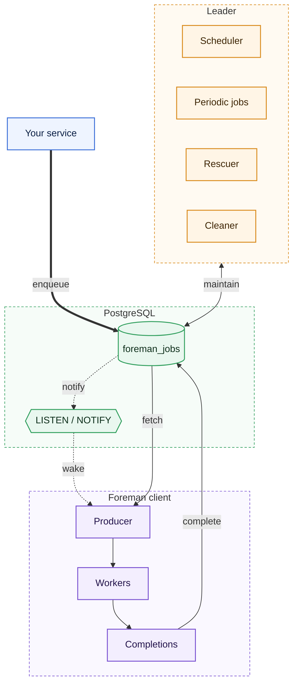

# Foreman

A Postgres-backed job queue for Go.

[](https://github.com/thnhdatle/foreman/actions/workflows/ci.yml)
[](https://github.com/thnhdatle/foreman/releases)
[](LICENSE)

## Architecture



Jobs are rows in Postgres, written in your transaction. Every client fetches and runs jobs; one
elected leader schedules, rescues and cleans up.

## Why

Background jobs often live in Redis or RabbitMQ, a second system that cannot join your database
transaction. Foreman stores jobs in the Postgres you already run, so a job is enqueued only if
your transaction commits. It also limits concurrency per tenant and keeps one busy tenant from
starving the others.

## Install

```sh
go get github.com/thnhdatle/foreman@v0.1.1                    # library
go install github.com/thnhdatle/foreman/cmd/foreman@v0.1.1    # admin CLI
docker run --rm ghcr.io/thnhdatle/foreman:v0.1.1 version      # admin CLI in Docker
```

Prebuilt CLI binaries for Linux and macOS are on the [releases page](https://github.com/thnhdatle/foreman/releases).

## Quickstart

Needs Go 1.27+ and Docker. From a clone of this repository:

<!-- quickstart:start -->
```bash
docker compose -f deploy/docker-compose.yml up -d --wait postgres
go run ./examples/basic
```
<!-- quickstart:end -->

It prints `job completed: id=1 state=completed`.

## Usage

```go
type EmailArgs struct {
	UserID int64 `json:"user_id"`
}

func (EmailArgs) Kind() string { return "email" }

type EmailWorker struct{}

func (EmailWorker) Work(ctx context.Context, job *foreman.Job[EmailArgs]) error {
	return sendWelcome(ctx, job.Args.UserID)
}

workers := foreman.NewWorkers()
foreman.AddWorker(workers, EmailWorker{})
client, err := foreman.NewClient(pool, foreman.Config{Workers: workers})

// Enqueue in the same transaction as your data.
_, err = client.InsertTx(ctx, tx, EmailArgs{UserID: id}, nil)
```

A job can run more than once if its worker dies, so make workers idempotent. Migrations,
shutdown, retries, cron, unique jobs and fairness are covered in the [guides](docs/guides).

## Performance

MacBook Pro M3 Pro 36 GB, Postgres 17 in Docker (8 CPU / 20 GB), Foreman v0.1.0, median of 3 runs.
Clients run natively; load is open-model (inserts at a fixed rate, never waiting for workers).

| Scenario | Result |
|---|---|
| Throughput, no-op jobs, 4 clients × 50 workers, 5 min | 35,518 jobs/s |
| Pickup latency p99 at 1,000 inserts/s, 2 min | 8.7 ms |
| Small tenant p95 wait behind a 240k backlog, fair vs unfair | 38 ms vs 64.6 s |
| 1 h soak at 1,000 jobs/s: table size drift, p99 drift | 0.3%, -0.1% |

## Documentation

- [Guides](docs/guides)
- [Roadmap](ROADMAP.md)
- [Changelog](CHANGELOG.md)
- [Contributing](CONTRIBUTING.md)
- [Security](SECURITY.md)
- [License: Apache-2.0](LICENSE)
